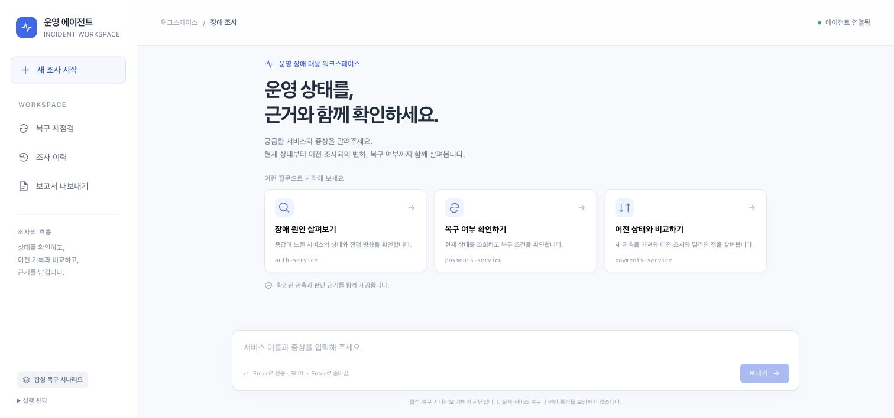
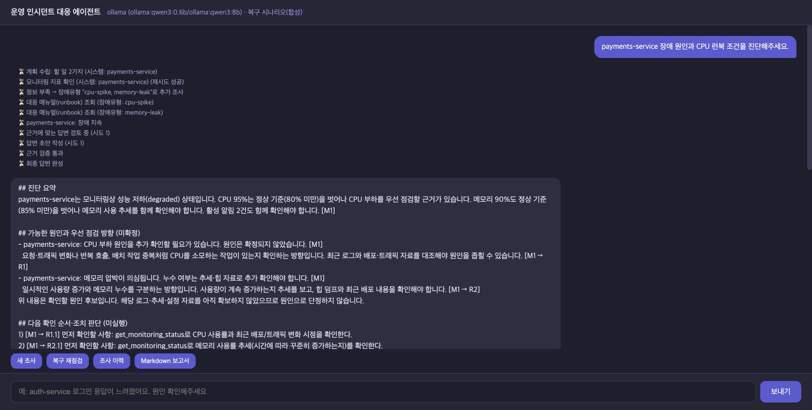

# AI Mini Project

**운영 장애 대응 에이전트의 상태 변화 비교·복구 확인 기능 개선**

- 선택 과제: **1번 — 제공 Base AI Agent 기능 개선/추가**
- 저장소: https://github.com/likefool1714/ai-miniproject (Public)
- 진행 계획 초안 제출 기한: **2026-10-20 17:00 KST**
- 현재 (2026-10-21): **처음 등록한 개선 5항목·추가 5항목을 로컬 샘플 환경에서 구현·검증**했습니다. 근거 검증과 상태 해석·점검 방향 설명도 보완했습니다. 과제 전체 제출 완료를 뜻하지 않습니다.
- 발표 자료: **Canva 표지 포함 9장 PPT, PDF, 5분 발표 대본**을 작성했습니다. 내일 실제 발표·연습은 별도입니다.
- 제공 API: `gpt-4o-mini` / `gpt-4o` 실제 기능 검사 통과. **LangSmith 실제 추적은 미검증**입니다.

[Canva에서 열기](https://www.canva.com/d/aVuXOpnbAcDEq69) · [최종 PPT](output/presentation/AI-Mini-Project_G028_최민석_Canva_v3_20261021.pptx) · [PDF](output/pdf/AI-Mini-Project_G028_최민석_Canva_v3_20261021.pdf) · [5분 발표 대본](docs/TALK_5MIN_CANVA.md) · [코드 설명·예상 질문](docs/DEFENSE_GUIDE.md)

기존 에이전트는 현재 모니터링 수치를 조회하고 런북으로 대응 절차를 작성합니다. 이번 작업은 **이전 조사와 비교하고 복구 여부를 다시 확인하는 기능**을 추가합니다.
CPU가 95%에서 55%로 내려가도 메모리·알림이 남아 있거나 정상 관측이 한 번뿐이면 복구를 확정하지 않습니다.

> 샘플 JSON·합성 시나리오 기반입니다. 실제 운영 서버 조회·자동 조치·실제 복구 증명이 아닙니다.

## 실제 API 재검증 (2026-10-22)

현재 `.env`의 키를 새로 읽어 3-2 방식의 실제 API 연결을 재검증했습니다. 공식 API 호출 **12건 모두 HTTP 200**을 확인했고, 일반 진단 POST **3건**·SSE **1건**, 복구 **5단계**·이력 **5건**·보고서 다운로드와 대상 처리 검사 **6요청**을 통과했습니다.
모니터링은 합성 데이터이며 LangSmith는 미검증입니다. 기존 77개 회귀 검사 및 과거 전후 비교와 별도 실행입니다.

[오늘의 검증 결과·사용량 요약](results/api-2026-10-22/README.md)

## 라이트 인터페이스 (2026-10-21)

조사 도구를 왼쪽에 모으고, 질문 예시·넓은 답변 카드·고정 입력창으로 화면을 재구성했습니다.
답변은 제목·목록·표로 표시하고 관측값·판단 근거는 항목별로 정렬합니다. 처리 과정과 모델 프롬프트는 펼쳐 볼 수 있으며, 답변 복사와 보고서 다운로드를 제공합니다.
작은 화면에서는 도구를 아이콘으로 줄이고 카드와 입력창을 너비에 맞춥니다.



[실제 화면·동작 확인 범위](results/ui-light-2026-10-21/README.md)

## 추가 감사와 버그 수정 (2026-10-21)

처음 등록한 기능 범위는 유지했습니다. 추가 감사에서 발견한 **수집 중 취소 시 연속성 누락, bool 백분율 허용, 제외 대상 조회, 확인 답변의 요청 분기 변경**을 수정했습니다.
기존 67개에 새 회귀 검사 10개를 더한 **77개 검사**와 동일 조건 전후 비교를 통과했습니다. 수정본 제공 API의 진단 POST 3건·SSE 1건, 복구 5단계·이력·보고서도 다시 확인했습니다.

[수정 내용·실행 원문·실제 채팅 스크린샷](results/bugfix-2026-10-21/README.md) · [처음 기획과의 대조 감사](docs/PLAN_ALIGNMENT_AUDIT_20261021.md)

이번 실제 화면 비교에서 원본은 정상 첫 관측으로 복구 완료를 답했고, 수정본은 정상 1/2회라며 보류 이유·다음 확인 조건을 설명했습니다.
고정 합성 관측의 단일 화면 비교이며 일반 정확도 측정은 아닙니다. 실제 채팅 화면과 개선 이유를 담은 9장 Canva 최종본을 저장하고 PPTX·PDF 및 5분 발표 대본을 갱신했습니다.

## 진단 답변 설명 보완 (2026-10-21)

초기 개선은 근거 검증에 집중해 수치와 런북 원문 위주로 답했습니다. 이를 보완해 **상태 해석 → 가능한 원인과 점검 방향 → 다음 확인 순서·조치 판단 → 수치·출처** 순서로 설명합니다.
예를 들어 CPU 89.5%는 정상 기준(<80%)을 벗어나 부하 점검이 필요하지만, CPU >90%라는 런북의 증설 조건은 충족하지 않는다고 구분합니다.
실제 조회한 런북을 바탕으로 반복 호출·배치 중복 등의 확인 방향을 설명하되, 원인 확정이나 조치 완료로 표현하지 않습니다.
복구 재점검도 무엇이 아직 비정상인지, 왜 정상 1회로 복구를 확정하지 않는지와 다음 확인 조건을 설명합니다.



[최신 전후 답변·검증 조건·실행 화면](results/explanation-2026-10-21/README.md)

설명 보완을 포함한 [전체 기능 재검증 기록](results/revalidation-2026-10-21/README.md): 67개 자동 검사, 정상 조건 392개 조합, 실제 웹 복구 흐름 3주기·15건, 6개 서비스 진단·대화 대상 유지, 이력·보고서와 CPU 89.5% 설명을 재확인했습니다.

[구현 사실 확인과 동작 설명](docs/FACT_CHECK_AND_FLOW.md)에서 검사 결과의 의미, 모델·코드의 역할, 사실·해석·원인 후보의 차이를 확인할 수 있습니다.

[현재 완료 범위·화면 확인·추가 기능 구분](docs/CURRENT_STATUS_AND_SCOPE.md): 등록 기능은 로컬에서 구현·검증했으며, 새 기능 제안과 남은 API 검증·발표 준비를 분리했습니다.

[새 핵심 기능 후보 전체 검토](docs/FEATURE_REVIEW.md): 연관 서비스 조사·영향 범위, 배포 변경 이력 연계, HTTP 기능 상태 확인을 비교했습니다. 후보는 아직 선택·구현하지 않았습니다.

발표 순서: **표지 → 기존 구조 → 추가한 처리 → 개선 전 실제 답변 → 개선 후 실제 답변 → 판정·근거 검증 코드 → 전후 비교 → 조사 이력과 보고서 → 한계**. `G028 최민석`은 표지 좌측 하단에만 작게 표기했습니다.

## 초기 질의응답 전후 기록 (설명 보완 전)

개선 전 제공 코드(`d1043ff`)와 복구·근거 검증 보완 버전(`1296a54`)에 같은 질문·고정 관측값을 넣어 실제 로컬 Ollama로 다시 실행했습니다.
서비스명 누락 시 대상 확인, CPU 런북 조건 비교, 일시적 정상화 시 복구 보류를 비교했습니다.

[세 비교의 원문·조건·스크린샷](results/qa-comparison-2026-10-21/README.md)에서 확인할 수 있습니다.
비교 이미지는 저장된 실제 답변을 표시한 별도 읽기 전용 화면입니다. 제품 채팅 화면 캡처도 함께 저장했습니다.
고정 MCP 입력을 주입한 사례 비교이며, 전체 진단 정확도나 운영 환경 성능 측정은 아닙니다.

## 등록한 범위와 구현 — 로컬 구현·검증 완료

| 구분 | 등록 내용 | 구현 |
|---|---|---|
| 개선 | 이전·현재 상태 비교 | CPU/메모리 변화(%p), 상태·알림 함께 비교 |
| 개선 | 복구·부분 회복·장애 지속·판단 보류 | 설정 파일의 정책으로 코드에서 판정 |
| 개선 | 일시적 정상화 처리 | 최근 장애 이후 최소 5초 간격 정상 2회 요구 |
| 개선 | 후속 대화 대상 유지 | 같은 thread의 대상 복원, 여러 대상이면 확인 질문 |
| 개선 | 데이터 부족 안내 | 첫 관측/오래된 자료/잘못된 자료는 판정 제한 |
| 추가 | 조사 이력 저장·조회 | SQLite, 대화·서비스별 분리, 재시작 후 유지 |
| 추가 | 상태 변화 비교 | 변화량과 알림 발생·해소 표시 |
| 추가 | 복구 재점검 | 사용자 요청 시 MCP Tool로 새 관측 조회 |
| 추가 | 장애 재발 감지 | 최근 복구 확인 이후 이상이 재관측되면 재발 표시 |
| 추가 | Markdown 보고서 | 현재 판정·이력·정책·한계를 포함한 다운로드 |

등록 항목과 구현의 대응표입니다. “이전·현재 상태 비교 개선”과 “상태 변화 비교 추가”처럼 같은 구현을 공유하는 항목이 있어, 10개의 독립 알고리즘을 구현했다는 뜻은 아닙니다.
[항목별 재검증 근거](results/revalidation-2026-10-21/README.md)를 보존합니다.

같은 관측 ID는 정상 횟수에 다시 추가하지 않습니다. 같은 ID의 내용 충돌·최근 재점검 실패는 보고서에서도 판단 보류합니다.
이력과 보고서 조회는 새 모니터링을 실행하지 않습니다.
조회 실패가 끼면 이후의 새 관측부터 정상 횟수를 다시 셉니다. 예전 ID의 재전송으로 최근 실패를 해소하지 않습니다.
실시간·보고서 현재 판정은 모두 최근 최대 500건을 사용하고, 보고서 이력 표는 최근 100건만 표시합니다.

## 처리 흐름

```text
Vue → FastAPI → 대화별 요청 직렬화 → 요청/대상 확인
  ├─ 일반 대화 → LLM 직접 응답
  ├─ 일반 진단 → 대상 확정 → 계획·게이트 → MCP 조회 → 부족한 런북 추가 조회
  │            → 관측 저장·복구 판정 → 구조화 제안 → 근거 검증 → 답변 + 정책 판정
  ├─ 복구 재점검 → MCP 조회 → 관측 저장 → 변화 비교 → 복구·재발 판정
  ├─ 조사 이력 → SQLite 조회
  └─ 보고서 → 최신 기록 유효성 재평가 → Markdown 다운로드
```

일반 진단의 분류·계획·원인 후보와 런북 항목 선택에는 LLM을 사용합니다.
모델은 근거 ID·원인 분류·런북 단계 ID를 제안하고, 코드는 출처와 서비스별 적용 가능성을 검사해 실제 수치와 문장을 구성합니다.
미수집 로그 분석·조치 실행을 모델의 자유 문장으로 보고하지 않습니다. 재작성은 한 번이며 실패 시 검증 보류, 일부 자료가 없으면 해당 부분을 보류합니다.
검증 전 진단 초안은 화면에 스트리밍하지 않습니다. 일반 대화는 기존 토큰 스트리밍을 사용합니다.
**새 복구 재점검의 수치 비교·최종 판정은 코드가 수행**하고 LLM 호출을 생략합니다.
기준을 일정하게 유지하고 지연을 줄이기 위한 선택입니다.

## 복구 정책

`data/recovery_policy.json`에서 관리합니다.

| 항목 | 기본값 |
|---|---|
| 정상 조건 | healthy, CPU < 80%, 메모리 < 85%, 활성 알림 0건 |
| 복구 확인 | 최근 장애 이후 정상 2회, 관측 사이 최소 5초 |
| 자료 유효시간 | 300초 |
| 재발 연관 기간 | 이전 복구 확인 후 3600초 |
| 이전 장애 기록 없음 | 현재 정상이어도 복구로 단정하지 않음 |

CPU 95% → 65%는 **-30%p**입니다. 지표 방향이 다르면 “혼재”로 표시합니다.
임계값·정상 2회 기준은 교육용 정책이며 실제 SLO가 아닙니다.

## 실행

검증 환경: Python 3.12, Ollama `qwen3:0.6b` / `qwen3:8b`.

```bash
# 최초 환경 준비
bash sh/setup_venv.sh

# 터미널 1: 이미 실행 중이면 중복 실행하지 않습니다.
ollama serve

# 터미널 2: 기본 샘플 모니터링 + 로컬 모델
LANGCHAIN_TRACING_V2=false LANGSMITH_TRACING=false \
LLM_BACKEND=ollama SUPERVISOR_VERSION=v2 .venv/bin/python server.py

# 터미널 3: 웹
.venv/bin/python -m uvicorn web_demo_server:app --host 127.0.0.1 --port 8600
```

웹: http://localhost:8600 / 상태: http://localhost:8100/health

### 복구·재발 데모

기본 난수 샘플은 회복 과정을 재현하지 않습니다. 고정 합성 시나리오는 다음처럼 백엔드를 실행합니다.

```bash
LANGCHAIN_TRACING_V2=false LANGSMITH_TRACING=false \
LLM_BACKEND=ollama SUPERVISOR_VERSION=v2 \
MONITORING_SCENARIO=recovery-demo SESSION_DB_PATH=recovery-demo.db \
.venv/bin/python server.py
```

1. **새 조사**를 누르고 `payments-service 복구 재점검`을 입력합니다.
2. **복구 재점검**을 네 번 누릅니다.
3. `장애 지속 → 부분 회복 → 부분 회복(정상 1회) → 복구 확인 → 장애 재발`을 확인합니다.
4. **조사 이력**, **Markdown 보고서**로 기록과 다운로드를 확인합니다.

시나리오는 대화·서비스별로 재생합니다. 마지막 스텝 재조회는 같은 ID이므로 횟수가 늘지 않습니다.
오래된 시나리오는 판단 보류하며 **새 조사**로 새 대화를 시작합니다.
추가 시나리오: `temporary-normal`, `stale-data`. 출처를 응답에 표시합니다.

### 제공 API 테스트 — 실제 기능 검사 완료 (2026-10-21)

실제 원격 API 모드에서 일반 진단 **POST 3건 + SSE 1건**이 근거 검증을 통과했습니다. 후속 복구 **5/5단계**, 이력 **5건**, Markdown 보고서 다운로드도 확인했습니다.
별도 브라우저에서도 진단·정상 1회 보류·정상 2회 복구·재발·이력을 확인했습니다. [원문·집계·실제 화면](results/api-2026-10-21/README.md)을 보존합니다.
모니터링은 합성 데이터이며 제한된 기능 호환 검사입니다. LangSmith 추적은 실제 확인하지 않았습니다.

브라우저·MCP·저장소·복구 정책은 유지하고 모델 백엔드를 원격 API로 전환합니다.
필요한 것은 제공받은 **유효 API 키, 허용 모델명, 접속 주소 확인**입니다. 현재 코드는 OpenAI 공식 Chat Completions 주소로 요청합니다. 수업에서 별도 프록시를 제공한 경우 접속 방식부터 대조해야 합니다.

1. `.env.example`을 로컬 `.env`로 복사하고 제공 키·허용 모델을 설정합니다. 기존 `.env`는 덮어쓰지 않습니다.
2. 기존 백엔드를 종료한 뒤 `MONITORING_SCENARIO=recovery-demo SESSION_DB_PATH=api-verification.db bash sh/run_agent_openai.sh`로 기동합니다.
3. `/health`의 `llm_backend=openai`를 확인하고 웹의 **새 조사**에서 `payments-service 장애를 진단해주세요`를 보냅니다.
4. 실제 모델 호출·진단 검증 결과를 확인한 뒤 같은 대화의 재점검 4회·이력·보고서를 확인하고 증거를 남깁니다.

위 순서는 재현 절차입니다. **서버 기동이나 복구 재점검만으로 API 호출 성공을 판정하지 않습니다.** 복구 재점검·이력·보고서는 LLM을 호출하지 않습니다. API로 바꿔도 모니터링 데이터는 합성입니다.
LangSmith는 별도 추적 설정·확인 대상입니다. [설정·실행·확인 항목 전체](docs/API_VERIFICATION.md)를 따릅니다.

## 검사·전후 비교

- **67개 자동 검사 통과**: 단위·로컬 stdio MCP·ASGI/API 검사이며 모델은 fake/mock입니다. 실제 Ollama 진단은 별도 기록합니다.
- 공개 정상 조건과 CPU·메모리·상태·알림을 바꾼 **392개 조합이 일치**했습니다. 실제 장애 정답률이 아닙니다.
- 제공 API 요청 계약 검사는 모의 HTTP이며, 유효 키를 사용하는 실제 API 호출과 구분합니다.
- 실제 브라우저에서 5단계 변화·이력·보고서 다운로드 확인.
- 개선 전 제공 코드(`d1043ff`)와 10월 20일 복구 기능 구현 버전에 같은 질문·고정 관측·고정 시계를 주입한 기록을 보존했습니다. 아래 첫 표는 그때의 실측이며, 현재 버전의 모든 검사를 원본과 다시 비교한 표가 아닙니다.
- 그래프 비교의 MCP는 고정 fixture입니다. 실제 MCP/HTTP 검사는 별도입니다.
- 원본에 구조화 판정이 없다는 이유만으로 자연어 답변을 오답 처리하지 않습니다.
- 기존 원본 18회 조사는 문제 탐색 기록이며 새 복구 기능의 비교와 구분합니다.

| 10월 20일 같은 관측 전후 비교 | 개선 전: 제공 코드 | 개선 후: 복구 기능 구현 버전 | 읽는 방법 |
|---|---|---|---|
| 정상 1회만으로 복구를 잘못 확정한 횟수 | 3/3건 | 0/3건 | 적을수록 좋음. 3회 모두 발생하던 문제가 관측되지 않음 |
| 복구 이후 다시 발생한 이상을 재발로 안내한 횟수 | 0/3건 | 3/3건 | 많을수록 좋음. 안내하지 못하던 3회 모두 재발 표시 |
| 5단계 정책 판정과 기대 결과 일치 | 자연어 원문 별도 검토 | 15/15건 | 5단계 × 3회 반복 |
| 고정 MCP fixture 그래프 지연 중앙값 | 28.79초 | 2.9ms | 개선 경로의 LLM 생략 효과 포함 |

`0/3`은 “3번 중 해당 행동이 0번”이라는 뜻입니다. 첫 행은 **잘못된 행동 0번**이라 개선이고, 둘째 행의 개선 전 값은 **필요한 재발 안내 0번**이라 보완 대상입니다. 같은 행에서 개선 전·후가 모두 `0/3`인 항목은 위 표에 없습니다.
원본 답변과 집계는 [당시 원문 대조 기록](results/recovery-2026-10-20/manual-review.json)에 보존했습니다.

지연 차이는 **새 복구 경로에서 LLM 호출을 생략한 효과를 포함**합니다. 실제 웹 응답시간으로 해석하지 않습니다.
위 비교 당시 별도의 웹 프록시·FastAPI·stdio MCP 복구 검사에서는 **15/15건** 기대 판정과 일치했고 중앙값은 **약 7.9ms**였습니다. 이 경로도 합성 데이터와 코드 기반 복구 판정을 사용합니다. 최신 일반 진단의 응답시간과 구분합니다.
수치는 이 고정 시나리오의 결과이며 일반 장애 진단 정확도를 의미하지 않습니다.

**10월 21일 최신 재검증**은 설명 보완까지 포함한 개선 코드가 전체 기능을 유지하는지 확인한 별도 검사입니다. 위 두 지표만 다시 확인한 것이 아닙니다.
실제 Ollama 웹 경로에서 첫 정상 관측의 복구 확정 보류 **3/3회**, 복구 후 재발 안내 **3/3회**를 재확인했고, 진단·대상 유지·예외·이력·보고서도 함께 검사했습니다. 원본은 이 최신 전체 검사에서 다시 실행하지 않았습니다.

| 2026-10-21 재검증 | 결과 | 측정 범위 |
|---|---|---|
| 실제 웹 일반 진단 | POST 8건 + SSE 1건 검증 통과 | 실제 Ollama·HTTP·MCP, 등록 6개 서비스 포함 |
| 복구 단계 | 15/15건 일치 | 5단계 × 독립 대화 3회. 최초 진단은 위 진단 건수에 포함 |
| 최초 일반 진단 응답시간 중앙값 | 약 9.96초 | 위 3회 최초 진단만 측정. 제공 API·일반 성능 수치가 아님 |
| CPU 89.5% 설명 | 검증 통과, `>90%` 조건 불충족 | 실제 Ollama 그래프, MCP 입력만 고정 fixture |
| 이력·보고서 | 3개 대화별 5건, 다운로드 확인 | 열람으로 새 관측을 추가하지 않음 |

이후 제공 API로 전환한 검사는 별도로 일반 진단 POST 3건·SSE 1건, 복구 5단계·이력·보고서를 확인했습니다. 원본/개선 비교와 API 연결 확인의 표본·목적을 구분합니다.
[최신 재검증 원문·측정 조건](results/revalidation-2026-10-21/README.md)과 [이후 새 대화로 확인한 결과](results/status-2026-10-21/live-check.json)를 참고하세요.
검사 간 대상이 겹치므로 합산해 독립적인 정답 수로 세지 않습니다. 위 Ollama 재검증 표는 원격 API 결과가 아니며, [별도 제공 API 검사](results/api-2026-10-21/README.md)도 모니터링 데이터는 합성입니다.

```bash
.venv/bin/python -m unittest discover -s tests -v
.venv/bin/python eval/compare_recovery.py --backend ollama --repetitions 3
# 일반 진단: 로컬 Ollama 연결 필요. web은 recovery-demo 서버를 먼저 실행합니다.
.venv/bin/python -m eval.probe_grounding writer --repeat 3
.venv/bin/python -m eval.probe_grounding web --repeat 3
```

[발표 대비 최신 재검증](docs/PROFESSOR_AUDIT.md) · [쉬운 코드 설명·예상 질문](docs/DEFENSE_GUIDE.md) · [일반 진단·근거 검증](docs/GROUNDING_VALIDATION.md) · [복구 기능 검증](docs/RECOVERY_VALIDATION.md) · [원본 검증](docs/BASELINE_VALIDATION.md)

[최종 Canva PPT — 표지 포함 9장](output/presentation/AI-Mini-Project_G028_최민석_Canva_v3_20261021.pptx) · [PDF](output/pdf/AI-Mini-Project_G028_최민석_Canva_v3_20261021.pdf) · [이전 표 중심 PPT](output/presentation/AI-Mini-Project_G028_최민석_Final_20261021.pptx)

## 평가 항목 대응

| 항목 | 대응 |
|---|---|
| 기능 완성도 30 | 등록 개선 5·추가 5항목의 로컬 검증, 실제 제공 API 진단·후속 기능 확인 |
| 전후 실측 보너스 10 | 같은 질문·관측, 원문·판정·시간·측정 범위 공개 |
| 기술 요소 30 | 기존 Multi-Agent/MCP, LangGraph 분기, Pydantic·권위 게이트·Validator, SQLite, 의존성 주입·검사 |
| 한계 20 | 확인 지연, 보수적 보류, 저장 비용, 정책·샘플 의존성 |
| PPT·발표 20 | Canva 표지 포함 9장, PPT·PDF·발표 대본 작성. 실제 발표 대기 |

RAG·LLM-as-a-Judge를 새 구현으로 기재하지 않습니다. 제공 API는 실제 확인했고 LangSmith는 미검증으로 구분합니다.

## 기술 및 직접 기여 범위

| 구분 | 제공 코드 재사용 | 이번에 직접 구현·수정한 범위 |
|---|---|---|
| 에이전트 흐름 | Supervisor·작업 분담·LangGraph·의존성 주입 틀 | 대상/후속 요청 확인, 재점검·이력·보고서 분기, 관측 저장과 검증 단계 연결 |
| MCP·런북 | 기존 Tool/Resource/Prompt와 제공 런북 | 관측 ID·출처, 대화별 합성 시나리오, 진단 결과와 근거 연결. 새 벡터 검색은 구현하지 않음 |
| 상태 판단 | 기존 현재 모니터링 조회 | `agent/recovery.py`: 변화량·정상 연속성·자료 유효성·복구·재발 정책 판정 |
| 저장 | 기존 SQLite 대화 메시지 저장 | `agent/recovery_store.py`: 서비스 관측·판정·대상·조회 실패 기록, 이력·보고서. 대화 저장 자체를 새 구현으로 세지 않음 |
| 답변 | 기존 모델 백엔드·분류·계획 | `agent/grounding.py`: 구조화 제안, 출처·서비스·항목 검증, 수치 조건 계산, 관측·런북에 연결한 설명 구성 |
| API·화면 | FastAPI·Vue·프록시·SSE | 기능 경로·버튼·Markdown 다운로드, 요청 잠금·시간 제한, 검증 전 진단 초안 전송 방지 |
| 검증 | 제공 실습 구조·고정 비교용 원본 | `tests/`, `eval/`: 정책·예외 검사, 원본/개선 비교, 실제 로컬 모델·MCP·웹 실행 기록 |

LLM은 분류·계획·원인 분류·런북 항목 선택에 사용합니다. 복구 판정·수치 비교·출처 검사는 코드가 수행하고, 최종 설명에는 제공 런북에 맞춰 작성한 해설을 사용합니다.
기존 Multi-Agent·MCP·런북 검색·의존성 주입을 처음부터 새로 만든 것으로 소개하지 않습니다. 새 LLM 심판·실제 로그 조회·자동 조치·배포 이력 연계·관련 서비스 자동 조사는 구현 범위에 포함하지 않습니다.
[파일별 기여 범위](docs/PROVENANCE.md) · [발표용 코드 설명](docs/DEFENSE_GUIDE.md)

## 주요 커밋과 변경 내용

커밋 번호는 특정 시점의 코드·문서를 찾아가기 위한 식별자입니다. 아래 설명은 기존 기록의 의미를 풀어 쓴 것이며 과거 커밋 번호나 메시지를 변경하지 않았습니다.

| 코드 상태·기록 | 변경 내용 | 커밋 |
|---|---|---|
| 개선 전 기준 | 제공받은 스켈레톤 코드를 처음 저장 | [d1043ff](https://github.com/likefool1714/ai-miniproject/commit/d1043ff) |
| 복구 기능 추가 | 조사 이력·상태 비교·복구 재점검·재발·보고서 연결 | [c4ad267](https://github.com/likefool1714/ai-miniproject/commit/c4ad267) |
| 근거 검증 보완 | 실제 관측·런북에 연결한 진단 제안 검증 | [c885d6c](https://github.com/likefool1714/ai-miniproject/commit/c885d6c) |
| 연속성·예외 보완 | 조회 실패 이후 연속 정상 처리와 진단 선택 범위 제한 | [1296a54](https://github.com/likefool1714/ai-miniproject/commit/1296a54) |
| 비교 증거 저장 | 원본·개선 질의응답과 실행 화면 추가. 제품 기능 변경은 없음 | [7416261](https://github.com/likefool1714/ai-miniproject/commit/7416261) |
| 설명 보완 | 수치의 의미·가능한 원인 점검 방향·조건부 조치 설명 추가 | [0972104](https://github.com/likefool1714/ai-miniproject/commit/0972104) |
| 최신 제품 코드 | 실제 허용 후보 수에 맞춘 생성 길이 제한 보완 | [b84065e](https://github.com/likefool1714/ai-miniproject/commit/b84065e) |
| API 확인·발표 자료 | 실제 제공 API 검사 결과와 최종 PPT·PDF·대본 반영 | [a3ccaff](https://github.com/likefool1714/ai-miniproject/commit/a3ccaff) |

“최신 제품 코드”와 “최신 저장소 커밋”은 다를 수 있습니다. 이후 문서·증거만 바뀐 커밋이 있어도 제품 기능이 새로 바뀐 것은 아닙니다.

## 일정과 진행 상태

| 단계 | 2026-10-21 기준 상태 | 근거·남은 일 |
|---|---|---|
| 과제 선택·공개 README 정리 | 완료 | 과제 1번, 등록한 개선·추가 범위 공개 |
| 10/20 핵심 구현·비교 | 완료 | 이력·비교·재점검·복구·재발·보고서, 고정 관측 Before/After 기록 |
| 10/21 진단 설명 보완·재검증 | 로컬 완료 | 근거 검증·상태 해석·점검 방향, 67개 자동 검사·392개 정책 조합·웹 실행 기록 |
| 제공 API 실제 확인 | 완료 | 일반 진단 POST 3건·SSE 1건 검증 통과, 복구 5단계·이력·보고서 확인 |
| LangSmith 실제 추적 | 미검증 | 별도 키·설정·실행 기록 생성 확인 |
| 최종 5분 발표 자료 | 작성 완료 | Canva 9장 PPT·PDF, 흐름에 맞춘 5분 대본. 내일 시간 측정·설명 연습 |
| 최종 제출 | 대기 | 재현 명령·저장소·제출 링크 점검. 과제 안내의 Day3 13:00 마감 기준 확인 |

사용자 일정: **10/21 오늘 API 실제 확인·최종 발표 자료까지 마무리**, **10/22 09:00~13:00 구현 이해·발표 연습**, **10/22 13:00 발표**입니다.
[오늘 마감·내일 오전 학습 순서](docs/REHEARSAL_PLAN.md) · [5분 발표 대본](docs/TALK_5MIN_CANVA.md)
API 실제 검사와 발표 파일 작성은 완료했고 발표 시각과 별도로 과제 제출 마감·링크를 확인합니다.

다음 작업은 **내일 오전 구현·코드 흐름 이해 → 5분 발표 연습 → 제출·발표 점검**입니다. LangSmith 실제 추적은 확인한 기술로 주장하지 않습니다.
관련 서비스 자동 조사·배포 이력 연계 등의 후보는 미확정·미구현이며, 등록 기능의 완료 범위에 포함하지 않습니다.

## 한계·트레이드오프

- 정상 2회·시간 간격 때문에 회복 판단이 늦을 수 있고 관측 사이 정상은 보장하지 않습니다.
- 사용자 결제 성공, 실제 원인 제거, 로그를 검증하지 않습니다.
- 규칙 기반 명령 해석은 지원 표현이 제한적이며 모호한 대상은 확인합니다.
- API는 최근 100건, 판정은 최대 500건을 읽습니다. 장기 보관·정리 정책은 미구현입니다.
- 로컬 데모로 인증·권한 통제, 운영 배포, 자동 조치, 주기적 감시는 범위 밖입니다.
- 근거 검증은 v2 일반 진단의 제한된 출력 구조에 적용합니다. 근본 원인·런북 자체의 정확성·일반 대화의 모든 사실을 검증하지 않습니다.
- 자유로운 설명 대신 근거·분류·런북 항목으로 출력을 제한하므로 표현력과 진단 범위가 줄어듭니다.
- cost_usd는 가상 단가 추정이며 실제 청구액이 아닙니다.

## 문서

[등록 내용](docs/REGISTRATION_DRAFT.md) · [개발 계획](docs/PROJECT_PLAN.md) · [코드 흐름](docs/CODE_WALKTHROUGH.md) · [평가](docs/EVALUATION.md) · [한계](docs/TRADEOFFS.md) · [발표 구성](docs/PRESENTATION_OUTLINE.md) · [수업 연결](docs/REQUIREMENTS_CROSSCHECK.md) · [출처](docs/PROVENANCE.md)

교육용 제공 코드 기반입니다. 개선 전 기준인 **제공 스켈레톤 최초 저장 커밋(`d1043ff`)**과 당시 실행 증거를 보존합니다.
과제 PDF·배포 ZIP·키·세션 DB는 커밋하지 않습니다.
