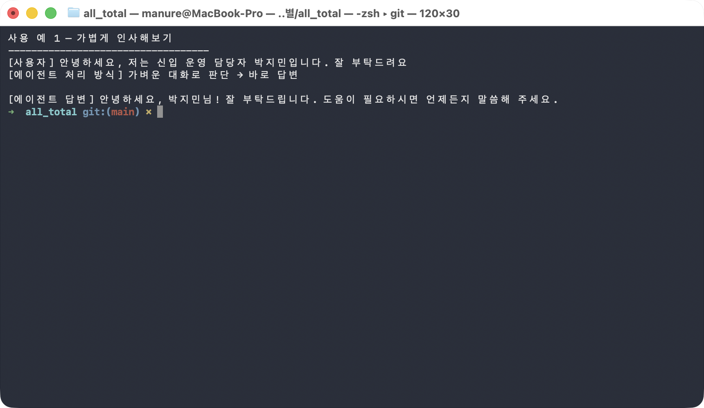
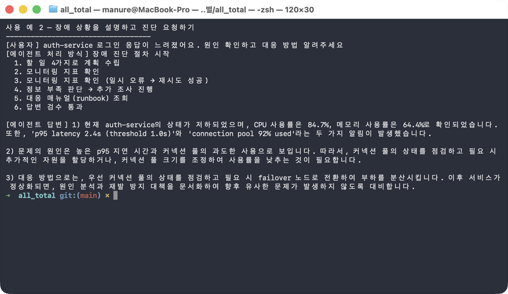
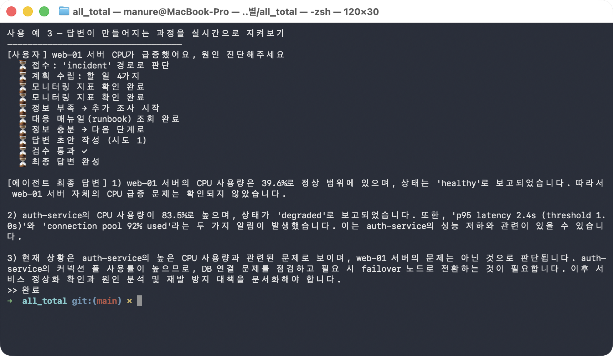
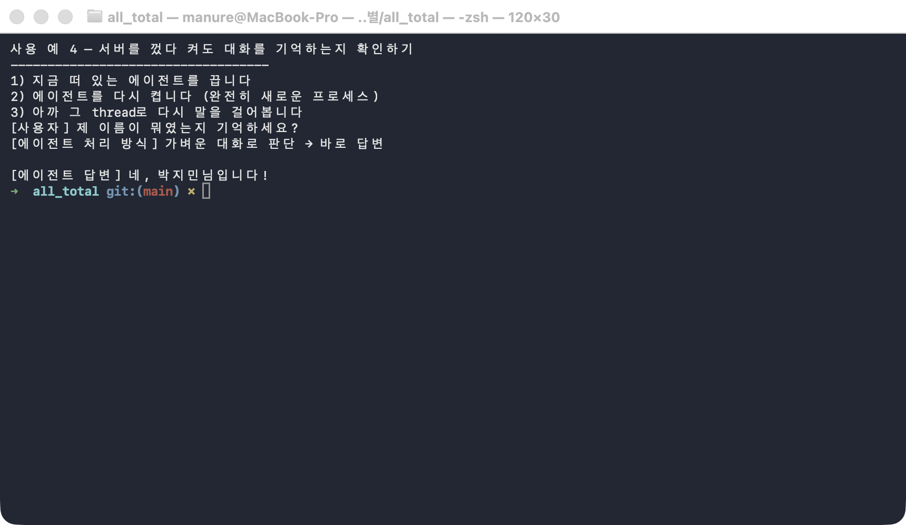
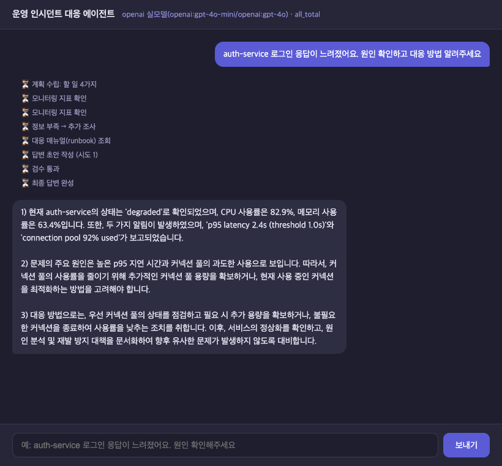
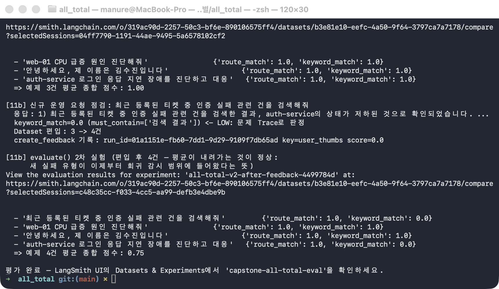

# 사용자 가이드 (OpenAI API 기준) — 이 에이전트로 무엇을 할 수 있나요?

이 폴더에는 **운영 중인 시스템의 장애를 진단해주는 AI 에이전트**가 들어있습니다. 사람이
매번 모니터링 화면을 뒤지고 매뉴얼을 찾아 읽는 대신, 채팅창에 상황을 설명하면 에이전트가
① 현재 서버 상태를 직접 확인하고 ② 회사 대응 매뉴얼(runbook)을 찾아보고 ③ 그 둘을 묶어서
"지금 무슨 일이 일어났고, 어떻게 조치해야 하는지"를 사람이 읽을 수 있는 문장으로 정리해
줍니다.

> 이 문서는 **"어떻게 켜는지"가 아니라 "켜져 있을 때 무엇을 물어볼 수 있는지"**에 집중한
> 문서입니다. 서버를 직접 띄우고 싶다면 [README.md](README.md)의 "주요 실행 방법"
> 표에서 `sh/run_agent_openai.sh`를 참고하세요.
> 아래 화면은 결정론적 Fake나 로컬 Ollama가 아니라 **실제 OpenAI API**(fast=`gpt-4o-mini`,
> quality=`gpt-4o`)를 직접 호출해 캡처한 **진짜 대화**입니다 — [manual_ollma.md](manual_ollma.md)와
> 같은 질문을 똑같이 던졌지만, 이번엔 실제 계정에 과금되는 호출이라 실행 횟수를 최소한으로
> 줄였습니다. 매번 조금씩 다른 문장·점수가 나올 수 있지만, 아래 소개하는 동작 방식 자체는
> 그대로 재현됩니다.

> ⚠️ **이 문서의 모든 화면은 실제 OpenAI 계정에 비용이 청구된 호출입니다.** 직접 따라
> 해보고 싶다면 본인 계정에 결제 수단이 연결돼 있는지, `.env`의 `OPENAI_API_KEY`가 유효한
> 본인 키인지 먼저 확인하세요.

## 한눈에 보는 5가지 사용 예

| # | 이럴 때 | 무엇을 해주나 |
|---|---|---|
| 1 | 그냥 가볍게 말을 걸고 싶을 때 | 장애 대응 같은 무거운 작업을 벌이지 않고 바로 대답 |
| 2 | "OO 서비스가 이상해요, 봐주세요" | 모니터링 수치 확인 + 매뉴얼 조회 → 원인과 대응 절차를 정리해 답변 |
| 3 | 답변이 나오기까지 뭘 하고 있는지 궁금할 때 | 진행 중인 각 단계를 실시간으로 보여줌 |
| 4 | 조금 전 나눈 대화를 계속 이어가고 싶을 때 | 서버가 재시작돼도 이전 대화 내용을 기억 |
| 5 | curl 말고 눈에 익은 채팅창으로 쓰고 싶을 때 | 같은 에이전트를 브라우저 채팅 화면으로 사용 |

---

## 사용 예 1 — 그냥 가볍게 인사해보기

장애 상황이 아니어도 괜찮습니다. 인사말이나 잡담에는 무거운 진단 절차를 돌리지 않고 가볍게
바로 대답합니다 — `gpt-4o-mini`만 짧게 한 번 호출하고 끝나기 때문에 비용도 거의 들지
않습니다(이 한 번의 호출에 든 비용은 1원 미만입니다).



에이전트가 "가벼운 대화"인지 "장애 신고"인지를 먼저 스스로 판단하기 때문에, 평소 대화하듯
말을 걸어도 됩니다. 이름처럼 대화 중에 알려준 정보는 뒤에서 기억해뒀다가(사용 예 4) 나중에
다시 활용합니다.

## 사용 예 2 — 장애 상황을 설명하고 진단 요청하기

실제로 쓸모가 생기는 지점입니다. "어떤 서비스가 어떻게 이상한지"만 자연어로 설명하면, 사람이
직접 모니터링 대시보드를 열어보고 매뉴얼 문서를 찾아 읽는 대신 에이전트가 그 일을 대신
합니다.



화면에 보이는 "에이전트 처리 방식" 목록이 바로 그 과정입니다.

1. **할 일 목록을 세운다** — 이번 요청을 처리하려면 뭘 확인해야 하는지 `gpt-4o-mini`가
   계획부터 세웁니다.
2. **모니터링 지표를 확인한다** — 해당 서비스의 현재 CPU·지연시간 같은 실측 수치를
   가져옵니다.
3. **부족하면 더 조사한다** — 모니터링 수치만으로 충분하지 않다고 판단되면(예: 대응
   매뉴얼을 아직 못 찾음) 스스로 조사를 한 번 더 추가합니다.
4. **회사 대응 매뉴얼(runbook)을 찾아본다** — "이런 상황에는 이렇게 대응하라"는 절차
   문서를 조회합니다.
5. **답변을 검수한다** — `gpt-4o`가 작성한 답변이 형식(번호 매긴 절차 등)을 제대로
   지켰는지 한 번 스스로 점검한 뒤에야 최종 답변으로 내보냅니다. 기준 미달이면 그 자리에서
   다시 씁니다.

즉, 받는 답변은 모델이 "그럴듯하게 지어낸 말"이 아니라 **실제 모니터링 수치 + 실제 매뉴얼
내용을 근거로 조합한 결과**입니다. 분류·계획처럼 가벼운 판단은 저렴한 `gpt-4o-mini`가,
최종 답변 작성처럼 품질이 중요한 부분은 `gpt-4o`가 맡는 식으로 모델을 나눠 쓰기 때문에,
모든 단계를 `gpt-4o`로 처리할 때보다 비용이 절약됩니다.

## 사용 예 3 — 답변이 만들어지는 과정을 실시간으로 지켜보기

장애 진단은 여러 단계(모니터링 조회 → 매뉴얼 검색 → 답변 작성 → 검수)를 거치기 때문에
몇 초가 걸릴 수 있습니다. "지금 멈춘 건지 일하고 있는 건지" 궁금하다면, 단계가 끝날 때마다
바로바로 화면에 찍어주는 방식으로 물어볼 수 있습니다.



사용 예 2와 내용은 같지만, 결과만 한 번에 받는 대신 ⏳로 표시된 각 단계가 완료되는 순간마다
실시간으로 올라옵니다. 이번 캡처에서는 에이전트가 모니터링 수치를 보고 "web-01은 사실
정상(healthy)이고, 진짜 문제는 auth-service 쪽"이라는 점까지 스스로 짚어냈습니다 — 질문에
적힌 서버 이름을 그대로 믿지 않고 실제 수치로 재확인한다는 뜻입니다.

## 사용 예 4 — 서버를 껐다 켜도 대화를 기억하는지 확인하기

이 에이전트는 방금 나눈 대화를 디스크에 저장해두기 때문에, 서버가 재시작되거나(배포·장애
복구 등) 완전히 새 프로세스로 떠도 이전 대화 맥락을 잃지 않습니다.



화면에서 실제로 일어난 일:

1. 사용 예 1에서 "박지민"이라고 이름을 알려준 뒤,
2. 에이전트 프로세스를 완전히 종료했다가 다시 켰고(메모리 상태는 전부 초기화됨),
3. 같은 대화(thread)로 "제 이름이 뭐였는지 기억하세요?"라고 물었더니 — `gpt-4o-mini`가
   SQLite에 저장된 이력을 읽고 **정확히 "박지민"을 기억해서 답했습니다.**

즉, 서버 재시작·배포·장애 복구가 일어나도, 또 프로세스가 완전히 새로 떠서 모델에게 그
순간의 기억이 전혀 없어도, 사용자와의 대화 맥락은 끊기지 않습니다.

---

## 사용 예 5 — curl 없이, 실제 웹 채팅 화면으로 사용하기

지금까지는 전부 터미널에서 `curl`로 말을 거는 방식이었습니다. 하지만 실제로 이 에이전트를
동료에게 보여주거나 써보게 하려면 커맨드라인보다는 **눈에 익은 채팅창**이 훨씬 편합니다.
이 폴더에는 그런 웹 채팅 화면(`web_chat.html` — 바닐라 JS 대신 Vue 3로 작성, CDN 글로벌
빌드라 별도 빌드 단계는 없음)과, 그 화면이 기존 에이전트 서버(8100)와 CORS 문제 없이
통신할 수 있게 중계만 해주는 아주 얇은 서버(`web_demo_server.py`)가 함께 들어있습니다 —
**기존 `server.py`는 전혀 수정하지 않습니다.**



헤더의 "openai 실모델(openai:gpt-4o-mini/openai:gpt-4o)" 표시는 화면이 접속 시
`/health`를 조회해 **현재 떠 있는 백엔드를 그대로 보여주는 것**입니다 — 서버를
`LLM_BACKEND=ollama`나 `fake`로 띄우면 같은 화면이 그 이름을 그대로 보여줍니다.

**직접 열어보기:**

```bash
# 1) 기존 방식대로 에이전트 서버를 먼저 띄운다 (OPENAI_API_KEY가 .env에 있어야 함)
LLM_BACKEND=openai SUPERVISOR_VERSION=v2 python3 server.py &

# 2) 채팅 화면용 중계 서버를 띄운다 (새 터미널에서, 같은 폴더)
python3 web_demo_server.py
```

브라우저에서 `http://localhost:8600`을 열면 바로 채팅을 시작할 수 있습니다. 내부적으로는
`web_demo_server.py`가 `/chat/stream` 요청을 그대로 8100번 포트로 전달(프록시)해줄 뿐이라,
답변 내용·진단 과정은 터미널로 직접 `curl`을 쳤을 때와 완전히 같습니다 — 다루기 쉬운 화면
하나만 앞에 둔 것뿐입니다. **다만 메시지를 보낼 때마다 실제 API가 호출되어 과금된다는 점은
동일합니다.**

---

## (운영자용) 에이전트가 이상한 답을 하고 있지는 않은지 자동으로 감시하기

지금까지의 5가지는 "이 에이전트를 어떻게 쓰는가"였다면, 이건 "이 에이전트를 책임지고
운영하는 사람"을 위한 기능입니다. 사람이 답변 하나하나를 매번 확인할 수는 없으니, 정해둔
예제 질문들을 주기적으로 다시 던져보고 **점수가 떨어지면 자동으로 알아차리는** 장치가 내장돼
있습니다.



실제로 일어난 일:

1. 미리 준비해둔 질문 3건(인사말 1건 + 장애 진단 2건)을 에이전트에게 다시 던져 채점합니다.
   점수는 "경로를 제대로 골랐는가"와 "답변에 꼭 들어가야 할 핵심 단어가 들어있는가"
   두 가지로 매깁니다 — 1차 평균은 1.00이었습니다.
2. 그러던 중 운영팀이 실제로 받은 새로운 질문 하나("최근 등록된 티켓 중 인증 실패 관련
   건을 검색해줘")를 테스트해봤더니, 에이전트가 이걸 **티켓 검색 요청인데 장애 진단
   절차로 잘못 처리**했습니다 — 점수 0점으로 즉시 걸러졌습니다.
3. 이 실패 사례를 감시 목록(예제 3건 → 4건)에 자동으로 추가하고, "이 답변은 별로였다"는
   피드백 기록을 남긴 뒤 전체를 다시 채점합니다.

캡처한 화면에서는 2차 채점에서 새로 편입된 질문뿐 아니라 기존 장애 진단 질문 하나도
핵심 단어(`failover`)를 답변에 쓰지 않아 함께 걸러지면서 평균이 1.00 → 0.75까지
내려갔습니다 — **실제 모델을 쓰기 때문에 실행할 때마다 정확한 점수는 달라질 수 있습니다**
(같은 질문의 [Ollama 버전](manual_ollma.md)에서는 1차부터 0.83이 나왔고, 2차에는 0.88로
오히려 올랐습니다 — 두 모델이 "어느 표현을 꼭 써야 할지"를 서로 다르게 판단한다는 뜻입니다).
핵심은 숫자 자체가 아니라, **"에이전트가 못하는 걸 찾아내면, 그 사례가 다음부터는 계속
감시 대상에 남는다"**는 구조입니다 — 한 번 걸러진 실수는 다시 조용히 묻히지 않습니다.

---

## Ollama(로컬 실모델) 버전과 비교하면

같은 서버·같은 그래프·같은 질문인데 LLM 자리에 무엇이 꽂히는지만 다릅니다
([manual_ollma.md](manual_ollma.md) 참고):

| | OpenAI API (이 문서) | 로컬 Ollama |
|---|---|---|
| 비용 | 요청마다 실제 과금 | 0원 (로컬 추론) |
| 응답 품질·속도 | 더 정교하지만 네트워크 호출 필요 | 가볍고 빠르지만 소형 모델 |
| 답변 문장·검증 횟수 | 실행마다 다름 | 실행마다 다름 |
| 코드 레벨 장치(재시도·병렬·세션) | 항상 동일하게 재현 | 항상 동일하게 재현 |

둘 다 **"gate·replan·validator가 연출이 아니라 실제 방어선으로 동작한다"**는 같은 결론을
보여줍니다 — 다만 그 방어선을 통과시키는 모델이 로컬 소형 모델이냐 상용 API냐만 다를 뿐,
`server.py` 코드는 한 글자도 바뀌지 않습니다.

## 더 알아보기

- 이 에이전트를 OpenAI 실API로 직접 켜고 싶다면: [README.md](README.md) "주요 실행 방법"
- 내부적으로 어떤 구성 요소가 맞물려 동작하는지(개발자 관점): [README.md](README.md)
  "아키텍처 구성도" · "주요 유스케이스별 고수준 시퀀스 다이어그램"
- 과금 없는 로컬 실모델 버전: [manual_ollma.md](manual_ollma.md)
