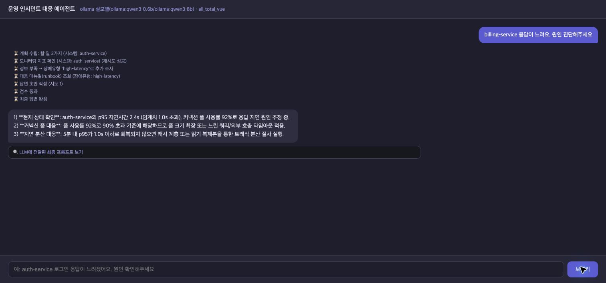

# 원본 스켈레톤 반복 검증

검증일: 2026-10-20 (한국 시간)

## 검증 목적과 범위

기능을 수정하기 전에 원본을 실행하고, 같은 시나리오 반복 실행 결과를 수집 근거/코드/웹 화면과 대조한다. 기대 동작은 개선 목표로 정의한 기준이며 제공 예제가 이미 보장하는 기능이라는 뜻은 아니다.

실행 기준은 `e9c540b`이다. 이 커밋의 제품 코드는 원본 보존 커밋 `d1043ff`와 같다. 실행 전후에 제품 코드/데이터/실행 파일 29개가 제공 기준과 동일함을 [SHA-256 기록](../results/baseline-2026-10-20/source-integrity.json)으로 확인했다. 이번 작업은 검증 실행기와 증거/문서를 추가하며 `agent/`, 서버, MCP, UI와 샘플 데이터는 수정하지 않는다.

## 환경과 관측 방법

- Python 3.12 전용 가상환경, 실제 설치 버전은 [의존성 기록](../results/baseline-2026-10-20/requirements-resolved.txt)에 보존한다.
- Ollama의 기본 모델 `qwen3:0.6b`(분류/계획), `qwen3:8b`(답변)를 사용한다.
- 외부 LangSmith 전송을 끄고 로컬 검증한다. 원격 API는 이번 검증 범위에 포함하지 않는다.
- API `127.0.0.1:8100`, 웹 프록시 `127.0.0.1:8600`을 실행한다. 모델 서버도 로컬이다.
- 제공 실행 스크립트는 시작 시 `session.db`를 삭제하므로 이번에는 같은 서버를 직접 실행해 기록을 보존한다.
- 서로 다른 모델 호출을 동시에 보내지 않고 시나리오를 순서대로 실행한다. 추론 중 health 확인은 별도 수행한다.
- SSE의 최종 프롬프트, 실제 조회 대상/매뉴얼, 단계별 이벤트, 최종 답변과 처리 시간을 저장한다.
- 각 반복에는 새 thread ID를 사용한다. 후속 문맥 검사는 해당 결제 서비스 요청의 같은 thread를 다시 사용한다.
- 모니터링 값에는 원본의 난수가 포함된다. 따라서 표현/지연의 반복 관측이며, After 성능 비교 시에는 별도의 고정 스냅샷이 필요하다.

## 검증 결과

6개 시나리오를 각 3회, 총 18회 실행했으며 모두 HTTP/SSE 응답을 완료했다. 라우팅(chat/incident)은 18/18 일치했다. 아래의 “기대 대상 처리 일치”는 대상 누락/미등록 시 조회 보류 및 복수 명시 대상 전부 조사라는 개선 기준과 비교한 값이다.

| 시나리오 | 완료 | 기대 대상 처리 일치 | 실제 조회 대상(회차순) | 중앙값(초) | 범위(초) |
|---|---:|---:|---|---:|---|
| 인사 | 3/3 | 3/3 | 조회 없음 / 조회 없음 / 조회 없음 | 1.273 | 1.23-8.902 |
| 결제 서비스 명시 | 3/3 | 3/3 | payments-service / payments-service / payments-service | 32.711 | 32.506-35.426 |
| 서비스명 누락 | 3/3 | 0/3 | auth-service / auth-service / auth-service | 32.816 | 31.814-44.766 |
| 미등록 billing-service | 3/3 | 0/3 | auth-service / auth-service / auth-service | 39.69 | 34.815-41.111 |
| 결제+캐시 복수 서비스 | 3/3 | 0/3 | payments-service / payments-service / payments-service | 54.015 | 50.25-60.16 |
| 게이트웨이 타임아웃 | 3/3 | 3/3 | gateway-service / gateway-service / gateway-service | 36.895 | 35.414-37.789 |

원시 이벤트/최종 프롬프트/답변은 [Ollama 기록](../results/baseline-2026-10-20/ollama/)에, 집계는 [summary.json](../results/baseline-2026-10-20/summary.json)에 저장했다. 단일 결제 요청과 게이트웨이 요청의 대상/매뉴얼 선택은 각각 3/3 일치했지만, 결제 요청의 근거 없는 로그 분석 완료 표현도 3/3 재현됐다. 응답 완료와 답변 정확성은 구분해야 한다.

## 확인된 문제와 원인

### 1. 서비스 누락/미등록 시 다른 서비스를 조사

`로그인 응답이 느려요, 원인 진단해주세요` 및 `billing-service 응답이 느려요. 원인 진단해주세요`에 대해 확인 질문 없이 `auth-service`를 조사하는 동작이 각각 3/3 재현됐다. 미등록 서비스를 요청한 경우에도 인증 서비스의 수치로 응답할 수 있다.

코드 근거: `agent/graph.py::_extract_system_name`, `agent/ollama_llm.py::_guess_target(s)`, `plan` 프롬프트와 정규화의 기본값이다. `openai_llm.py`에도 유사 기본값이 있지만 원격 실모델에서 재현했다고 주장하지 않는다.

개선: 등록된 대상 집합을 코드에서 검증하고, 대상이 없거나 미등록이면 후보/확인 질문을 반환한다. 확인 전 모니터링을 호출하지 않는다.

### 2. 복수 서비스 요청에서 일부 조사 누락

`payments-service랑 cache-service 둘 다 저하됐는데 공통 원인이 있는지 분석해줘` 요청에서 결제 서비스만 조회하는 동작이 3/3 재현됐다. 답변이 캐시 데이터가 없다고 표시하더라도 사용자가 요청한 조사 자체가 빠진 것이다.

코드 근거: `OllamaFastLLM.plan`은 research 작업이 아예 없을 때만 `_guess_targets()`로 복구한다. 일부만 있으면 누락 대상을 보충하지 않는다. 통제된 모델 출력에서도 동일하게 확인했다.

개선: 사용자에게 명시된 대상 집합과 실행 계획의 대상 집합을 대조하고 누락을 보충한다. 임의로 추가한 대상도 제거/확인한다.

### 3. 조회하지 않은 로그를 분석 완료로 표현

명확한 결제 서비스 요청에서 답변이 `로그 분석 결과 특이 패턴 없음`이라고 표현한 사례를 확인했다. 저장된 최종 프롬프트에는 모니터링 수치, 대응 매뉴얼 및 모니터링 기반 패턴 분석이 있으며 실제 로그 조회 결과는 없다. 매뉴얼의 “로그에서 확인한다”는 권고를 실제 완료한 조사처럼 표현하는 문제이다.

결제 서비스의 세 번 반복 답변 모두에 이 로그 분석 완료 표현이 있었다. 또한 복수 서비스 요청의 3회차 답변에는 `현재 CPU 89.5%로 90% 기준 충족`이라는 잘못된 수치 비교가 있었다.

수집된 CPU/메모리 숫자가 해당 답변에서 맞았다는 사실과, 수행하지 않은 로그 분석을 주장하거나 수치를 잘못 해석한 문제는 구분한다. 답변 전체를 자동 사실성 평가기로 채점한 결과는 아니다.

코드 근거: `validate_node`는 30자 이상과 `1)` 포함 여부만 확인한다. 통제된 잘못된 문장 `1) 실제 수집 결과와 무관하게 CPU가 999%라고 단정합니다.`도 통과한다. 실패한 짧은 답변도 3번째 시도에는 통과 처리된다.

개선: 관측 사실/분석/권장 조치를 구분하고, 관측 수치는 수집값과 대조한다. 조회하지 않은 출처의 분석 완료를 표현하지 않도록 검증한다. 실패 시 무조건 “합격”시키는 대신 검증 실패/제한된 답변 상태를 표시한다.

### 4. 런북 분류의 제한 (통제된 규칙 입력으로 확인)

영어 CPU/메모리/네트워크 알림의 단일 유형은 예상 매뉴얼을 선택했다. 그러나 한국어로만 쓴 CPU 증상과 healthy+알림 없음은 `db-down`으로 분류됐다. CPU와 메모리 알림을 함께 넣으면 우선순위가 앞선 CPU 매뉴얼 하나만 선택한다.

이 항목은 실제 모델의 모든 한국어 질의가 실패했다는 뜻이 아니다. 현재 샘플 알림은 영어이므로 평범한 한국어 질문이어도 영어 알림을 조회하면 맞는 매뉴얼을 찾을 수 있다. 분류 함수가 사용자 질문과 실제 수치 자체를 사용하지 않는 점을 분리해서 확인한 것이다.

개선 후보: 정상/정보 부족 상태를 명시하고, 여러 대상/증상별로 매뉴얼을 선택한다. 의미 기반 검색(RAG)은 후보이나 현재 6개 문서에서 항상 더 정확하다는 근거는 없으므로 별도 검색 평가가 필요하다.

### 5. 후속 장애 요청에서 이전 조사 대상이 유지되지 않음 (보조 검사)

3회 반복의 결제 서비스 요청 중 첫 번째와 같은 thread에서 `그 서비스의 메모리도 진단해줘`라고 요청했다. 정상 응답은 약 55.3초 후 반환됐지만, 결제 서비스 대신 `auth-service`를 조회했다. 이는 추가 검사 1건의 완료 결과이며 3/3 재현이라고 주장하지 않는다.

서버는 history를 읽지만 `route_node`와 `plan_node`에서 LLM에 현재 query만 전달한다. 대화 저장 기능과 장애 조사 문맥 유지 기능을 구분해야 한다. 개선 시 확인 대기 상태와 원래 증상/명시 대상을 함께 관리한다.

### 6. 장시간 생성과 작업 중단 처리 (보조 검사)

두 번째 후속 검사에서는 모델이 수분 동안 생성을 계속했다. Ollama 콘솔에서 최소 4,267개 생성 토큰과 context shift를 관측했다. 직전 기록 이후 약 280초에 검증용 요청/모델/백엔드를 **수동 중단**했으며 이는 자연 발생한 서버 타임아웃으로 기록하지 않는다. 세 번째 후속 검사는 실행하지 않았다. 본 검증 18회는 이 중단 전에 이미 모두 완료했다.

생성이 영원히 끝나지 않는다고 단정하지 않는다. 원본 LLM 요청에는 명시적인 생성 토큰 상한이 없고, 사용자 요청 전체에 대한 시간 예산/취소 처리도 별도로 설계할 필요가 있다. 이후 검증용 서버를 같은 원본 설정으로 재기동했다.

개선 후보: 모델별 출력 예산, 요청 전체의 제한 시간, 취소/실패 이벤트와 웹 오류 안내. 일반적인 정상 응답의 33-54초 중앙값과 이 장기 생성 사례를 구분한다.

보조 원시 기록은 [완료 요청](../results/baseline-2026-10-20/ollama/followup-1.json), [수동 중단 기록](../results/baseline-2026-10-20/ollama/followup-2-aborted.json), [미실행 기록](../results/baseline-2026-10-20/ollama/followup-3-not-run.json)으로 구분했다.

## 웹 화면 교차 확인

재기동 후 웹에서 미등록 `billing-service`를 입력했다. 화면에 실제 조사 대상이 `auth-service`로 표시되고 해당 수치의 최종 답변이 나오는 것을 확인했다. 보내기 버튼이 다시 활성화되어 스트림 종료도 확인했다. [화면 텍스트](../results/baseline-2026-10-20/web-unknown-service.txt)와 아래 캡처를 보존했다.



## 정상 확인 항목

- 실제 Ollama 모델을 사용하는 서버와 Vue 화면이 기동했다.
- 단일 결제 서비스/게이트웨이 요청에서 지정 대상과 해당 CPU/네트워크 매뉴얼을 조회한 사례를 확인했다.
- SSE로 단계 이벤트와 답변 토큰/최종 답변을 받았다.
- 최초 모니터링 호출의 의도적인 일시 실패는 POST 사전 점검에서 재시도 1회 후 복구됐다.
- 별도 SQLite 저장소를 닫고 다시 열어 이력을 읽는 검사 및 일시 오류 재시도 검사는 각각 3회 성공했다. 실제 서버 재시작 테스트와 구분한다.
- 추론 중 health 요청 8회는 모두 HTTP 200이었다. 작은 관측 범위이며 동시 사용자 부하 테스트는 아니다.

## 개선 우선순위 제안

오늘 완료를 우선하면 두 묶음으로 제한한다.

1. **조사 대상 검증 및 확인 대화**: 누락/미등록 확인, 복수 대상 누락 방지, 확인 대화의 증상/대상 유지.
2. **근거를 대조하는 응답 검증**: 관측 사실과 권장 조치를 분리하고 수집되지 않은 수치/조사 완료 표현을 막는다.

런북 RAG는 여전히 가능한 기능이나, 이번 실제 실행에서는 잘못된 대상 조사와 근거 없는 완료 표현이 더 직접적으로 드러났다. 처음 제안한 RAG를 필수로 고정하지 않고 이 실측 결과를 바탕으로 기능 범위를 정한다. RAG를 선택한다면 사용자 증상+알림, 다중 증상, 낮은 검색 점수/정보 부족 처리까지 평가해야 한다.

## 재현

프로젝트 루트에서 원본 서버를 켠다. 이번 `.venv`에는 필요 패키지가 설치되어 있다.

```bash
# 터미널 1: Ollama가 이미 실행 중이면 중복 실행하지 않는다.
ollama serve

# 터미널 2: 세션 DB 삭제 없이 원본 백엔드 실행
LANGCHAIN_TRACING_V2=false LANGSMITH_TRACING=false \
LLM_BACKEND=ollama SUPERVISOR_VERSION=v2 .venv/bin/python server.py

# 터미널 3: localhost에서 웹 프록시 실행
.venv/bin/python -m uvicorn web_demo_server:app --host 127.0.0.1 --port 8600

# 별도 터미널: 새 출력 경로에 6종을 각 3회 기록
.venv/bin/python eval/probe_baseline.py --rounds 3 --output results/baseline-rerun/ollama

# 분리된 규칙/의존성 검사 (모델 추론 없음)
LANGCHAIN_TRACING_V2=false LANGSMITH_TRACING=false \
PYTHONPATH=. .venv/bin/python eval/probe_rules.py
```

기존 증거를 덮어쓰지 않도록 baseline 실행기는 round 기록이 있는 출력 경로를 거절한다. followup/summary 실행기는 이번 날짜의 증거 경로를 사용하는 감사용 도구이다. 보조 검사 당시 클라이언트 대기 제한은 480초였으며, 장기 생성 관측 후 보조 실행기의 재실행 제한을 120초로 낮추고 기존 증거 덮어쓰기 방지를 추가했다. 제품 코드는 바꾸지 않았다.

## 해석 한계

한 대의 로컬 머신, 한 모델 조합, 소규모 시나리오의 반복 관측이다. 세 번 반복은 재현 여부를 보는 용도이며 일반화된 성능 수치나 통계적 유의성을 보장하지 않는다. 단계별 이벤트는 조사 수행을 확인하는 근거이고, 최종 프롬프트는 모델에 전달된 입력을 확인하는 근거이다. 샘플 시스템의 실제 운영 장애를 진단한 결과는 아니다.
