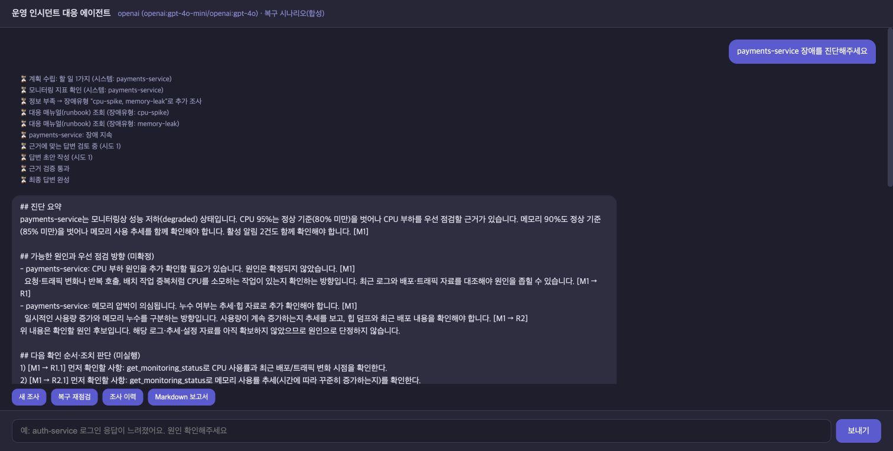

# 제공 API 실제 연결·기능 확인 — 2026-10-21

제품 코드의 마지막 변경은 `b84065e`이며 이번 검사에서 제품 코드는 수정하지 않았다.
`LLM_BACKEND=openai`, `SUPERVISOR_VERSION=v2`, `MONITORING_SCENARIO=recovery-demo`로 실행했다.
모델은 `gpt-4o-mini` / `gpt-4o`이고 HTTP 프록시·FastAPI·stdio MCP·실제 원격 모델 API를 사용했다.
모니터링 데이터는 합성이며 실제 운영 서버를 조회한 검사는 아니다.

## 결과

| 검사 | 결과 | 범위 |
|---|---|---|
| 최소 모델 연결 요청 | HTTP 200, OK | fast 모델 실제 응답. 이 최소 요청의 사용량만 13토큰 |
| 일반 진단 POST | 3/3건 근거 검증 통과 | 결제, 결제+캐시, 정상 웹 서비스 |
| SSE 진단 | 1/1건 근거 검증 통과 | 검증 전 AnswerToken 0건 |
| 후속 복구 흐름 | 5/5단계 일치 | 최초 진단 포함, 같은 대화·결제 서비스 |
| 조사 이력·보고서 | 관측 5건, Markdown 다운로드 | 열람으로 새 관측 추가 안 됨 |
| 수동 브라우저 확인 | 별도 진단·5단계·이력 확인 | 자동 검사 건수와 분리. 화면 5장 저장 |

최초 결제 진단 1건은 약 **4.62초**였다. 단일 관측값이며 로컬의 3회 중앙값 9.96초와 동일 조건의 속도 비교가 아니다.
원격 API로 바꾼 뒤 수치 의미·CPU/메모리 점검 방향·조건부 조치·근거가 함께 나오는지 답변을 읽고 확인했다.
복수 서비스는 각 서비스의 관측과 원인 후보가 연결되고, 정상 웹 서비스에는 현재 정상과 복구 확정의 차이를 안내했다.
미수집 로그·배포 이력을 확인한 것처럼 보고하거나, 재시작·확장을 실행했다고 주장하지 않는지 확인했다.

후속 단계는 `장애 지속 → 부분 회복 → 부분 회복(정상 1회) → 복구 확인 → 장애 재발`이다.
재발은 내부 `ongoing` 상태에 `recurrence=true`가 붙는다. 관측 시각 10초 간격은 합성 입력이며 실제 서버를 그 간격으로 측정한 것이 아니다.

## 증거

- [실제 최소 연결 응답](connection.json): 토큰 사용량은 이 요청만의 값이다.
- [자동 기능 검사 집계](web-summary.json), [POST 응답 원문](web-responses.json), [SSE 이벤트](sse-events.json).
- [다운로드 보고서](report.md).
- [진단 화면](app-diagnosis.jpg), [정상 1회 보류](app-normal-once.jpg), [정상 2회 복구](app-recovered.jpg), [재발](app-recurrence.jpg), [이력](app-history.jpg).



## 재현과 한계

```bash
# 로컬 .env에 제공 키와 허용 모델 설정 후, 기존 백엔드는 정상 종료한다.
MONITORING_SCENARIO=recovery-demo SESSION_DB_PATH=api-verification.db bash sh/run_agent_openai.sh
# 다른 터미널: 웹이 꺼져 있을 때 실행
.venv/bin/python -m uvicorn web_demo_server:app --host 127.0.0.1 --port 8600
# 실제 API를 호출하는 제한된 호환 검사
.venv/bin/python -m eval.probe_provided_api --output results/api-rerun
```

- 일반 진단의 실제 모델 호출을 확인했다. 재점검·이력·보고서는 LLM을 호출하지 않는다.
- 최초 진단 1건은 복구 5단계에도 포함된다. POST/SSE와 복구 수치를 독립 표본처럼 합산하지 않는다.
- 전체 호출의 실제 비용·토큰 총합은 수집하지 않았다. 화면 `cost_usd`는 가상 단가 추정이다.
- 제한된 사례의 기능 호환 검사이며 일반 장애 정확도나 모든 응답의 사실성을 보장하지 않는다.
- LangSmith는 별도 유효 키가 없어 실제 추적을 확인하지 않았다. API 키와 추적 키는 다르다.
- 인증 값·헤더·로컬 `.env`·세션 DB는 결과에 저장하거나 커밋하지 않았다.
