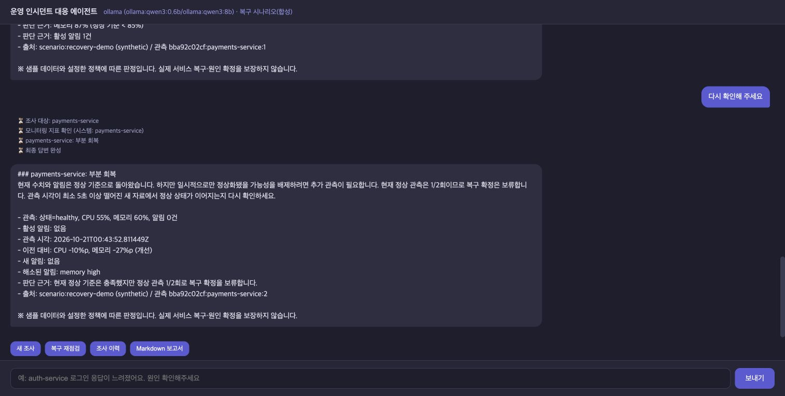

# 진단 답변의 설명 보완 — 2026-10-21

초기 근거 검증 답변은 수치·출처에 비해 “무엇이 문제이고 다음에 무엇을 확인해야 하는가” 설명이 부족했다.
현재 상태의 의미, 런북에 근거한 원인 점검 방향, 조건부 조치와 다음 재점검 조건을 답변 앞에 추가했다.

## 변경 내용

| 부분 | 직전 버전 7416261 | 설명 보완 b84065e |
|---|---|---|
| 일반 진단 | 수치·ID·런북 원문 중심 | 상태 해석 → 가능한 원인과 점검 방향 → 다음 순서·조치 판단 → 수치·출처 |
| CPU 89.5% | `89.5% > 90% → 불충족` 표시 | 정상 기준(<80%)을 벗어나 CPU 부하를 점검하되, 런북의 증설 조건은 충족하지 않는다는 의미까지 설명 |
| 원인 후보 | CPU 부하 원인 추가 확인 필요 | 실제 조회한 CPU 런북에 따라 반복 호출·배치 중복·배포/트래픽 변화의 확인 방향 설명 |
| 복구 재점검 | 상태·변화량·정상 관측 횟수 | 왜 개선됐어도 복구가 아닌지, 남은 문제와 다음 관측 조건을 문장으로 설명 |

숫자 비교·복구 판정 정책은 바꾸지 않았다. 원인 후보를 확정 사실로 표현하거나 조치를 실행했다고 표현하지 않는다.
모델은 원인 분류와 런북 절차를 선택하고, 검증을 통과한 선택과 관측으로 답변을 구성한다.

## 실제 앱 화면

Vue → FastAPI → stdio MCP → SQLite·검증 → 실제 Ollama 진단 경로로 확인했다.
데이터는 recovery-demo 합성 시나리오다. CPU·메모리 95/90에서 두 자원 이상을 함께 해석하고, CPU·메모리 런북의 점검 방향을 설명했다.
브라우저에서 “근거 검증 통과”를 확인하고 캡처했다.


같은 대화에서 복구 재점검 버튼을 두 번 눌렀다. 중간 65/87 상태에서는 메모리·알림 점검을 안내하고, 정상 55/60 관측이 처음 나오면 왜 아직 복구 확정이 아닌지와 최소 5초 간격의 다음 관측을 설명했다.
복구 재점검의 판정·설명은 코드로 처리하며 LLM 생성이 필요하지 않다.



## 동일 입력 비교 및 검증

- [responses.json](responses.json): 직전 버전과 보완 버전의 같은 질문·같은 고정 MCP 입력 비교. 대상 확인, CPU 진단, 장애→정상 관측 두 단계. 총 8응답 완료.
- [CPU 설명 보완 전](cpu-before.md), [CPU 설명 보완 후](cpu-after.md): 같은 관측(CPU 89.5%, 메모리 55%, CPU 알림)의 답변 전체.
- [summary.json](summary.json): 비교 범위와 코드 버전, CPU 진단 검증 통과 기록.
- [tests.txt](tests.txt): 67/67 검사 통과. 기본 검사에서는 모델을 fake/mock으로 대체하고 로컬 MCP·API를 검증한다. 전체 67건이 실제 LLM 응답 검사는 아니다.
- [web-extra-responses.json](web-extra-responses.json): 실제 HTTP·MCP·Ollama에서 정상 web-01과 지연 알림 auth-service의 설명·검증 통과 확인.

고정 입력 비교는 각 버전의 그래프·Ollama 연결 코드를 실제 실행했다. MCP 입력만 fixture로 주입했으므로 전체 HTTP·stdio MCP 속도 비교가 아니다.
실제 브라우저 앱 화면은 고정 입력 비교와 별도의 recovery-demo 관측을 사용한다.

초기 실모델 검사에서는 같은 CPU 원인 분류를 중복 선택해 두 번 반려되고 검증 보류로 전환됐다.
[initial-duplicate-selection.json](initial-duplicate-selection.json)에 그 결과도 보존했다.
실제 허용된 원인 항목 수에 맞춰 생성 길이를 제한하고 다시 검사해 최종 CPU 진단이 검증을 통과했다.
CPU·메모리 두 종류가 모두 해당하면 서로 다른 두 원인 분류를 함께 선택할 수 있다. 검증 기준을 완화하지 않았다.

## 코드 설명과 한계

`grounding.explain_observation`은 현재 관측과 설정된 정상 기준을 비교해 상태를 설명한다.
`render_answer`는 모델이 선택한 분류·절차를 검증한 뒤 상태 해석과 다음 확인 방향으로 구성한다.
미리 검토한 해설은 제공 런북 6종의 절차 전체가 조회한 자료와 일치할 때만 붙인다. 문서가 달라지면 해당 해설을 생략하고 실제 조회한 절차를 제공한다.
새 문서를 자유롭게 요약·설명하는 기능까지 구현한 것은 아니다. 조치 분류 표시는 제공 절차의 문자열 규칙을 사용하며 실제 실행 권한이나 실행 기능은 없다.

`recovery.explain_assessment`는 판정 결과에서 남은 문제·보류 이유·다음 확인 조건을 설명한다.
정상 관측 사이의 시간 동안 계속 정상이라는 것과 실제 사용자 요청 성공까지 증명하지 않는다.
제공 API·LangSmith 실제 연결은 이 검사에 포함하지 않았다. PDF·PPT는 생성하지 않았다.

```bash
.venv/bin/python -m unittest discover -s tests -v
.venv/bin/python -m eval.capture_qa_comparison --baseline-commit 7416261 --output results/explanation-2026-10-21
```

재실행 시 모델 답변과 시간이 달라질 수 있다. JSON은 갱신되며 스크린샷은 자동 갱신되지 않는다.
