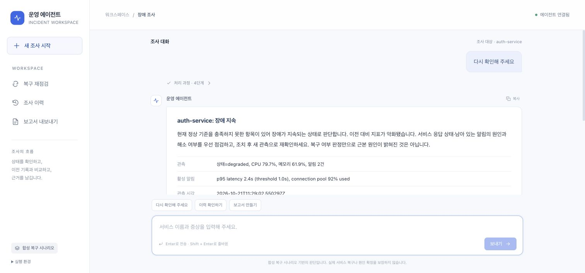
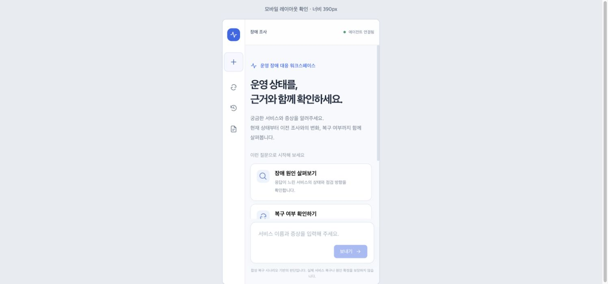

# 라이트 인터페이스 동작 확인 (2026-10-21)

`web_chat.html`의 화면 배치·표현·입력 처리를 개선했다. 에이전트의 복구 정책·MCP 연결·저장 형식은 변경하지 않았다.

## 변경

- 밝은 배경, 왼쪽 조사 도구, 연결 상태, 질문 예시, 고정 입력창.
- 넓은 결과 카드와 제목·목록·표 표시, 관측값과 근거의 항목별 정렬.
- 실행 중 처리 과정 표시, 완료 후 접기, 상세 프롬프트 접기.
- 답변 복사, 보고서 다운로드 링크, Enter 전송·Shift+Enter 줄바꿈·한글 조합 중 전송 방지.
- 응답 중 중복 전송 방지, 사용자가 위를 읽을 때 자동 스크롤 억제.
- 390px 화면에서 도구 아이콘화·단일 열 질문 카드·하단 입력창.

## 실제 브라우저 확인

- 예시 질문 선택 시 입력창에 채움, Enter로 요청 전송.
- 제공 API 일반 진단 1건의 진행 상태·최종 답변·모델 프롬프트 표시 확인.
- payments-service의 장애→부분 회복→정상 1회 보류→정상 2회 복구 확인.
- 조사 이력 4건 조회, Markdown 보고서 표 및 다운로드 링크 표시.
- 후속 재점검이 같은 서비스로 연결됨, 새 조사 버튼의 입력·화면 초기화 확인.
- 답변 복사 버튼에 ‘복사됨’ 표시, 처리 과정 펼치기·접기 확인.
- JavaScript 구문 검사 및 Markdown 렌더링 검사: HTML 모양의 모델 출력은 텍스트로 유지, 표·관측 항목과 기존 답변/보고서 입력 처리.
- 브라우저에서 수집된 warning/error 로그 없음.

이번 확인은 화면과 주요 사용 흐름의 동작 검사다. 전체 77개 백엔드 회귀 검사를 이번 UI 변경 후 다시 실행한 것은 아니다.
모니터링은 합성 자료이며 실제 장애 복구를 검증한 것은 아니다. 이번에는 다운로드 링크 표시를 확인했고, 내려받은 파일 내용의 재검사는 하지 않았다.
Markdown 표시는 제목·목록·강조·인라인 코드·코드 블록·단순 표를 지원하는 제한된 렌더러다. HTML을 삽입하지 않는다.

## 실제 화면

모바일 사진은 데스크톱 브라우저 안의 너비 390px iframe이며 실제 휴대폰 촬영이 아니다. 대화 스크린샷은 화면에 보이는 영역이며 긴 답변은 스크롤해서 읽는다.
